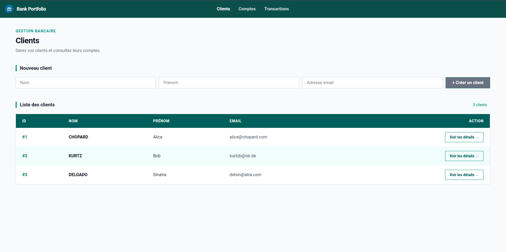
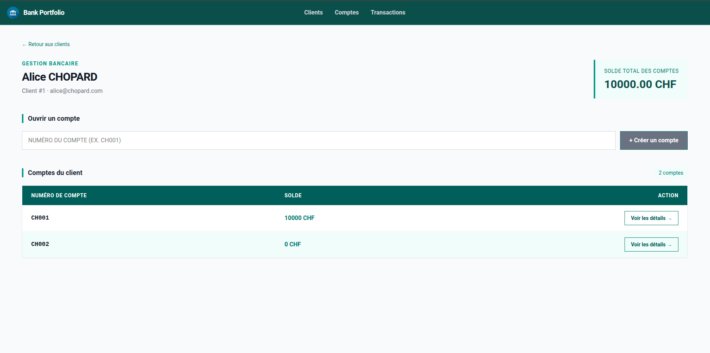
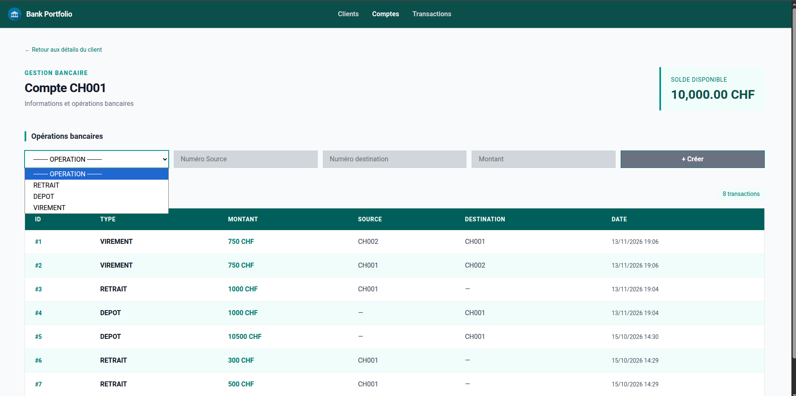

# Bank Portfolio — Angular & Spring Boot

A full-stack banking management application built with **Angular**, **Spring Boot**, **Java 21**, **JDBC**, and **SQLite**.

The project provides a responsive web interface for managing banking clients, consulting accounts, and performing financial operations through a REST API.

## Features

- View and register banking clients
- Consult client details and associated bank accounts
- Create and browse bank accounts
- View account balances and transaction histories
- Perform deposits, withdrawals, and transfers between accounts
- Update account balances and transaction lists in the interface after successful operations
- Persist banking data with SQLite and JDBC
- Execute financial operations using database transactions (`commit` / `rollback`)
- Display loading states and API error messages

## Screenshots

### Clients



### Client Details and Accounts



### Account Details and Transactions



## Tech Stack

| Technology | Purpose |
| --- | --- |
| Angular | Single-page frontend application |
| TypeScript | Frontend application logic and types |
| Tailwind CSS | Responsive user interface |
| Java 21 | Backend development |
| Spring Boot | REST API and backend application |
| Spring MVC | HTTP controllers and request handling |
| JDBC | Database access |
| SQLite | Relational data persistence |
| Maven | Backend build and dependency management |
| npm | Frontend dependency management |

## Architecture

The application separates the user interface from the banking API and business logic.

The backend follows a layered architecture: controllers expose API endpoints, the service layer implements banking operations, and repositories handle database access. API responses use a consistent JSON structure with `success`, `message`, and `data` fields.

### Banking Operations

- **Deposit:** credit an account and record the transaction.
- **Withdrawal:** debit an account according to the application's banking rules and record the transaction.
- **Transfer:** move funds between accounts and record the operation.

Database transactions help keep balance updates and transaction records consistent if an operation fails.

## Project Structure

```text
spring-angular-banking-app/
├── frontend/                 # Angular application
│   ├── public/
│   ├── src/
│   ├── angular.json
│   ├── package.json
│   └── package-lock.json
├── backend/                  # Spring Boot REST API
│   ├── database/             # Database scripts (SQLite file excluded)
│   ├── src/
│   ├── pom.xml
│   ├── mvnw
│   └── mvnw.cmd
├── docs/
│   ├── clients.png
│   ├── client-details-and-comptes.png
│   └── compte-and-transactions.png
└── README.md
```

## REST API

Selected endpoints used by the Angular application:

| Method | Endpoint | Description |
| --- | --- | --- |
| `GET` | `/api/clients` | List clients |
| `GET` | `/api/clients/{id}` | Get client details and accounts |
| `POST` | `/api/clients` | Create a client |
| `GET` | `/api/comptes` | List bank accounts |
| `GET` | `/api/comptes/{numero}` | Get account details and transactions |
| `GET` | `/api/comptes/client/{clientId}` | List a client's accounts |
| `POST` | `/api/comptes` | Create an account |
| `POST` | `/api/comptes/deposit` | Deposit funds |
| `POST` | `/api/comptes/withdraw` | Withdraw funds |
| `POST` | `/api/comptes/transfert` | Transfer funds |
| `GET` | `/api/transactions` | List transactions |

## Getting Started

### Prerequisites

- **Java 21**
- **Node.js and npm** compatible with the Angular version declared in `frontend/package.json`
- No separate SQLite server is required

### 1. Clone the Repository

```bash
git clone https://github.com/romualdfolly/spring-angular-banking-app.git
cd spring-angular-banking-app
```

### 2. Start the Spring Boot Backend

In a terminal:

```bash
cd backend
./mvnw spring-boot:run
```

The backend is configured to serve the REST API at **http://localhost:8082/api**.

The SQLite database file is intentionally excluded from Git. Review the database initialization scripts and backend configuration when setting up a fresh local database.

### 3. Start the Angular Frontend

In a second terminal, from the repository root:

```bash
cd frontend
npm ci
npm start
```

Open **http://localhost:4200** in your browser.

The Angular environment configuration should point to the backend API at `http://localhost:8082/api`. If you change the backend port, update the frontend API base URL accordingly.

## Database

SQLite stores three core domain entities:

- **Client:** customer information
- **Compte:** bank account information and balance
- **Transaction:** deposits, withdrawals, transfers, and transaction history

The database file (`backend/database/bank.db`) is not committed to the repository. Use fictional data for local development and screenshots.

## Project Evolution

This application is part of an evolving banking portfolio:

1. **Java SE + JDBC + SQLite:** banking domain models, persistence, and financial operations.
2. **[Spring Boot + Thymeleaf](https://github.com/romualdfolly/bank-portfolio-spring-boot):** server-rendered banking management application.
3. **[Spring AI + MCP](https://github.com/romualdfolly/bank-portfolio-ai-mcp):** AI-powered banking assistant connected to banking services.
4. **Angular + Spring Boot (this repository):** separate single-page frontend and REST backend, with typed HTTP communication and interactive banking operations.

This repository focuses on **full-stack application development and REST API integration**, without requiring an AI or MCP component.

## Disclaimer

This is an educational portfolio project, not a production banking platform. All displayed banking data should be fictional.
